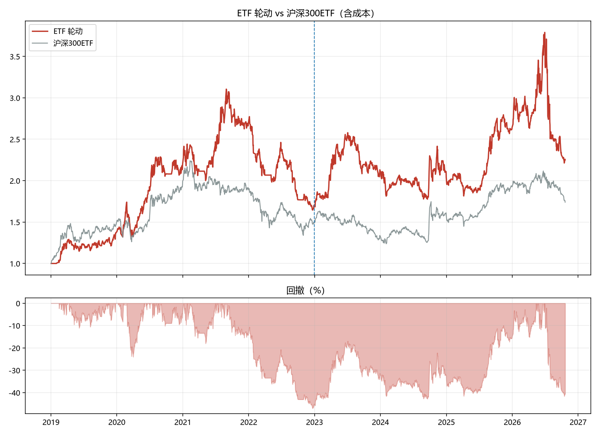
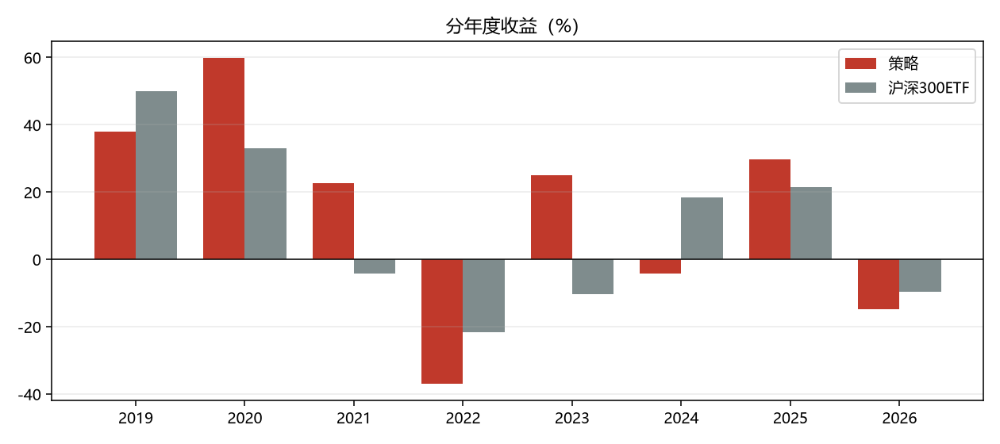

# ETF 轮动策略

- 股票池：25 只宽基 + 行业 ETF
- 信号：月末按「20 日动量 / 波动率」排序，取前 3 只等权
- 空仓规则：最强动量 < 0 时持现金
- 成交：月末信号，次日开盘
- 成本：佣金 2.5bp + 滑点 5.0bp，ETF 免印花税

## 绩效

| 指标 | 样本内 | 样本外 | 全期 |
|---|---|---|---|
| 累计收益 | 70.57% | 33.72% | 125.13% |
| 年化收益 | 14.85% | 8.30% | 11.43% |
| 年化波动 | 26.66% | 29.66% | 28.15% |
| 夏普比率 | 0.653 | 0.417 | 0.525 |
| 最大回撤 | -47.00% | -41.61% | -47.00% |
| Calmar | 0.316 | 0.200 | 0.243 |
| 日胜率 | 47.58% | 50.38% | 48.91% |

## 沪深300ETF 基准

| 指标 | 样本内 | 样本外 | 全期 |
|---|---|---|---|
| 累计收益 | 49.44% | 16.09% | 74.01% |
| 年化收益 | 10.98% | 4.18% | 7.67% |
| 年化波动 | 23.15% | 18.40% | 20.97% |
| 夏普比率 | 0.566 | 0.315 | 0.457 |
| 最大回撤 | -40.22% | -24.15% | -44.75% |
| Calmar | 0.273 | 0.173 | 0.171 |
| 日胜率 | 51.29% | 48.31% | 49.87% |

## 分年度

| 年份 | 策略 | 沪深300ETF |
|---|---|---|
| 2019 | 38.04% | 49.90% |
| 2020 | 59.90% | 33.04% |
| 2021 | 22.66% | -4.32% |
| 2022 | -37.00% | -21.68% |
| 2023 | 24.93% | -10.43% |
| 2024 | -4.31% | 18.39% |
| 2025 | 29.58% | 21.49% |
| 2026 | -14.80% | -9.61% |

## 参数敏感性

| 窗口 / 持仓数 | 年化 | 夏普 | 最大回撤 | 样本外年化 |
|---|---|---|---|---|
| (10, 1) | -0.028 | 0.096 | -0.650 | 0.068 |
| (10, 2) | -0.047 | -0.003 | -0.711 | -0.045 |
| (10, 3) | 0.014 | 0.194 | -0.667 | -0.034 |
| (10, 5) | 0.053 | 0.329 | -0.649 | 0.034 |
| (20, 1) | 0.167 | 0.616 | -0.527 | 0.014 |
| (20, 2) | 0.103 | 0.471 | -0.516 | 0.076 |
| (20, 3) | 0.114 | 0.525 | -0.470 | 0.083 |
| (20, 5) | 0.093 | 0.473 | -0.440 | 0.065 |
| (60, 1) | 0.111 | 0.468 | -0.710 | 0.015 |
| (60, 2) | 0.092 | 0.437 | -0.584 | 0.031 |
| (60, 3) | 0.119 | 0.534 | -0.478 | 0.077 |
| (60, 5) | 0.124 | 0.574 | -0.475 | 0.118 |

## 图

